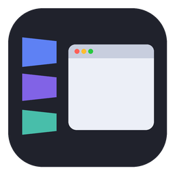

# Stage Manager for Windows

<p align="center"></p>

<p align="center">
  <b>macOS 스테이지 매니저를 Windows에서.</b><br>
  지금 쓰는 창은 가운데에, 나머지 창은 왼쪽에 카드로 모아 두고 한 번에 바꿉니다.
</p>

<p align="center">
  <a href="https://github.com/ilfpns/Mulddungddunge/releases/latest"><b>⬇ 최신 버전 받기</b></a>
  &nbsp;·&nbsp; Windows 10 (1903 이상) / 11, 64비트 &nbsp;·&nbsp; 무료 &nbsp;·&nbsp; 설치 파일 하나
</p>

---

## 목차

1. [설치](#1-설치)
2. [처음 5분](#2-처음-5분)
3. [사용법](#3-사용법)
4. [단축키 한눈에 보기](#4-단축키-한눈에-보기)
5. [설정](#5-설정)
6. [자주 묻는 질문](#6-자주-묻는-질문)
7. [알려진 제한](#7-알려진-제한)

---

## 1. 설치

1. [Releases](https://github.com/ilfpns/Mulddungddunge/releases/latest)에서 **`StageManager-<버전>-win64.exe`** 를 받습니다.
2. 받은 파일을 실행합니다. 관리자 권한은 필요 없습니다.
3. "Windows를 시작할 때 자동으로 실행할까요?"에 답하면 끝입니다.

> **"Windows의 PC 보호" 파란 창이 뜨면?**
> 코드 서명 인증서가 없는 프로그램이라 처음 한 번 뜨는 경고입니다. **추가 정보 → 실행**을 누르세요.

- 따로 깔아야 하는 프로그램(.NET, VC++ 재배포 패키지 등)은 **없습니다.**
- 설치하지 않고 쓰려면 **`StageManager-<버전>-portable.zip`** 을 받아 압축을 풀고 `stage-manager.exe`를 실행하세요.
- **지우기:** Windows **설정 → 앱 → 설치된 앱**에서 "Stage Manager for Windows"를 제거합니다. 설정과 바꿔 둔 Windows 설정까지 모두 원래대로 돌아갑니다.

---

## 2. 처음 5분

1. 실행하면 지금 창 하나만 화면 가운데에 남고, **나머지 창은 왼쪽에 비스듬한 카드**가 됩니다.
2. **카드를 클릭**하면 그 창이 날아와 가운데에 뜨고, 쓰던 창은 카드로 들어갑니다.
3. 키보드로는 **Alt+1, Alt+2 …** 로 위에서부터 차례대로 바꿉니다. **Alt를 잠깐 누르고 있으면** 카드마다 번호가 보입니다.
4. 창을 **최소화**하면 그 자리에서 카드로 빨려 들어갑니다.
5. 창을 크게 띄우면 사이드바가 화면 밖으로 비킵니다. **마우스를 화면 왼쪽 끝**에 대면 다시 나옵니다.

끄려면 작업 표시줄 오른쪽 **트레이 아이콘을 우클릭 → 종료**.

---

## 3. 사용법

### 창 바꾸기

| 이렇게 하면 | 이렇게 됩니다 |
|---|---|
| 카드 클릭 / **Alt+1~9** | 그 창이 가운데로 오고, 쓰던 창은 카드로 |
| **Alt를 누르고 있기** | 카드마다 단축키 번호가 보임. 사이드바가 숨어 있었으면 잠깐 나왔다가 Alt를 떼면 다시 들어감 |
| Alt+Tab, 작업 표시줄, 새 창 열기 | 평소처럼 바뀌고, 쓰던 창은 카드로 |
| 카드를 **화면 가운데로 끌어다 놓기** | 지금 창은 그대로 두고 그 창을 옆에 함께 띄움 |
| 창 두 개를 화면 분할(Win+←/→)로 나란히 | 둘 다 가운데에 남고, 사이드바 쪽 창은 사이드바 옆으로 알아서 맞춰짐 |
| **바탕화면 빈 곳 클릭** | 떠 있는 창이 모두 카드로 들어감(macOS처럼). 설정에서 끌 수 있음 |
| 가상 데스크톱 전환 | 데스크톱마다 그 데스크톱의 창만 카드로 보임 |

### 카드 정리하기

| 이렇게 하면 | 이렇게 됩니다 |
|---|---|
| 카드를 끌어 **다른 카드 위에 놓기** | 순서가 바뀌고, 다시 켜도 그 순서 그대로(앱 기준) |
| 카드 우클릭 → **탭 고정** | 사이드바 맨 위에 자리를 지킴. 그 창을 열면 빠졌다가 내리면 같은 자리로 |
| 카드 우클릭 → **창 닫기 / 앱 종료** | 창만 닫거나, 앱을 통째로 종료(백그라운드까지). 저장 확인 창이 뜨면 그대로 둠 |
| 카드 우클릭 → **크기 맞추기** | 그 창을 정해 둔 위치·크기로 맞춰 엶 |
| 카드 우클릭 → **데스크톱 N으로 보내기** | 다른 가상 데스크톱으로 옮김(Windows 11 24H2 이상) |

### 폴더 — 비슷한 창을 하나로 묶기

| 이렇게 하면 | 이렇게 됩니다 |
|---|---|
| 카드를 끌어 **다른 카드 위에 2초 들고 있기** | 테두리 빛이 다 차면 두 카드가 **폴더**로 묶임(최대 4개, 2×2 그림) |
| 폴더 클릭 | 안의 카드가 펼쳐져 나오고, 하나를 골라 엶 |
| 펼친 폴더에서 카드를 빈 곳으로 끌어내기 | 폴더에서 빠짐 |
| 폴더 우클릭 → **모두 열기** | 폴더 안 창들이 화면을 나눠 한꺼번에 뜸(2개 반반, 3개 반+반반, 4개 4등분) |
| 폴더 우클릭 → **이름 바꾸기** | 카드 아래에 이름표. Enter로 저장, Esc로 취소 |
| 폴더 우클릭 → **폴더 고정 / 폴더 풀기** | 맨 위에 고정하거나 다시 낱장 카드로 |
| Alt+숫자 | 폴더 안 창도 하나씩 번호를 가짐. 예: 1 / 2 / [3, 4] 이면 Alt+4가 폴더의 둘째 창 |

폴더(이름과 들어 있는 앱)는 **다시 켜도 그대로** 묶입니다. 그 앱들의 창이 열리면 알아서 다시 모입니다.

### 알림과 소리

| 이럴 때 | 카드에 |
|---|---|
| 앱에 새 메시지가 옴(작업 표시줄이 깜빡일 때) | **주황 점**과 카드를 도는 빛. 그 창을 열면 사라짐 |
| 앱이 소리를 냄 | 왼쪽 위에 **스피커**. 누르면 그 앱만 음소거/해제 |

### 그 밖에

- **파일을 카드 위로 끌어 2초 들고 있기:** 그 창이 열려서 파일을 바로 놓을 수 있습니다.
- **파일 열기 같은 대화상자:** 원래 창과 한 카드로 함께 움직입니다.
- **카카오톡처럼 X를 누르면 트레이로 숨는 앱:** 카드가 남아 있어 누르면 다시 열립니다.
- **크롬·엣지에 설치한 웹앱(YouTube 등):** 브라우저가 아니라 그 웹앱 로고로 보입니다.
- **전체화면 게임·영상:** 사이드바와 Alt 단축키가 완전히 비켜 줍니다.

---

## 4. 단축키 한눈에 보기

| 단축키 | 하는 일 |
|---|---|
| **Alt+1 ~ Alt+9** | 위에서 N번째 카드의 창으로 바꾸기 |
| **Alt 누르고 있기** | 카드 번호 보기 |
| Esc (이름 바꾸는 중) | 이름 바꾸기 취소 |

단축키 조합은 설정에서 **Ctrl+Alt** 또는 **Shift+Alt** 로 바꿀 수 있습니다(다른 프로그램과 겹칠 때).

---

## 5. 설정

**사이드바 빈 곳 우클릭**(또는 트레이 아이콘 우클릭) → **설정**. 바꾸는 즉시 적용되고 다시 켜도 유지됩니다.

| 탭 | 바꿀 수 있는 것 |
|---|---|
| **일반** | 시작 시 자동 실행, 단축키 켜기·조합, 보이는 카드 수(1~6), 사이드바 위치(왼쪽/오른쪽), 쓸 모니터 |
| **모양** | 카드 기울기·크기, 애니메이션 속도(끄기 포함), 썸네일 화질, 아이콘만 보기(가장 가볍게), 테두리 빛 색(앱 로고 색 포함)·굵기, 대체 카드 모양(회색/유리) |
| **동작** | 창이 가리면 사이드바 숨기기, 화면 끝으로 다시 불러오기, 분할 창을 사이드바 옆에 맞추기, 트레이로 숨는 앱 카드 유지, 알림·소리 표시, 바탕화면 클릭으로 모두 넣기 |
| **앱** | 앱마다 카드로 관리할지, **X로 종료**(트레이로 숨는 앱을 X로 완전히 끄기) |
| **고정** | 고정한 카드 목록 보기·해제 |
| **정보** | 버전, 메모리 사용량 |

---

## 6. 자주 묻는 질문

<details>
<summary><b>사이드바가 안 보여요.</b></summary>

창이 사이드바 자리를 가리면 사이드바가 화면 밖으로 비킵니다. **마우스를 화면 왼쪽 끝**(오른쪽에 두었다면 오른쪽 끝)에 대면 나옵니다. Alt를 잠깐 누르고 있어도 나옵니다. 전체화면 게임·영상 중에는 완전히 숨습니다.
</details>

<details>
<summary><b>컴퓨터가 느려지지 않나요?</b></summary>

가만히 있을 때 CPU·GPU 사용률은 거의 0%, 메모리는 약 4~8MB입니다. 애니메이션은 Windows 화면 합성기가 그래픽카드로 처리하고, 창 미리보기는 실시간 영상이 아니라 카드로 들어갈 때 한 장만 찍습니다. 더 가볍게 쓰려면 설정 → 모양 → **아이콘만 보기**를 켜세요.
</details>

<details>
<summary><b>작업 관리자에서 GPU 메모리가 계속 늘어나요.</b></summary>

작업 관리자 **세부 정보** 탭의 "전용 GPU 메모리"는 Windows 카운터의 알려진 오류로 실제보다 계속 늘어 보입니다([Microsoft 안내](https://learn.microsoft.com/troubleshoot/windows-client/performance/gpu-process-memory-counters-report-wrong-value)). 실제 사용량은 **성능** 탭이나 설정 → 정보에서 보세요(약 20MB).
</details>

<details>
<summary><b>창을 최소화할 때 Windows 기본 애니메이션이 안 보여요.</b></summary>

카드로 빨려 들어가는 애니메이션과 겹치지 않도록 실행 중에만 꺼 둡니다. 종료하거나 제거하면 원래대로 돌아오고, 갑자기 꺼졌더라도 다음 실행 때 되돌립니다.
</details>

<details>
<summary><b>카카오톡을 X로 닫았는데 카드가 남아 있어요.</b></summary>

카카오톡은 X를 누르면 꺼지지 않고 트레이로 숨습니다. 그래서 카드를 남겨 두고, 누르면 다시 엽니다. 완전히 끄려면 카드 우클릭 → **앱 종료**, 또는 설정 → 앱에서 **X로 종료**를 켜세요.
</details>

<details>
<summary><b>특정 앱은 카드로 만들고 싶지 않아요.</b></summary>

설정 → **앱** 탭에서 그 앱을 끄면 사이드바가 관리하지 않습니다.
</details>

<details>
<summary><b>설정을 처음 상태로 되돌리고 싶어요.</b></summary>

앱을 끈 뒤 레지스트리 편집기에서 `HKCU\Software\StageManager`를 지우면 설정·고정·폴더가 모두 초기화됩니다. 제거 후 다시 설치해도 됩니다.
</details>

<details>
<summary><b>오류가 났어요.</b></summary>

`%TEMP%\stage-manager.log` 파일을 [Issues](https://github.com/ilfpns/Mulddungddunge/issues)에 첨부해 주세요. 더 자세한 기록이 필요하면 빈 파일 `%TEMP%\stage-manager.trace`를 만든 뒤 앱을 다시 켜면 동작 기록이 남습니다(파일을 지우고 다시 켜면 꺼짐).
</details>

---

## 7. 알려진 제한

- 한 번에 **모니터 하나**만 관리합니다(설정에서 선택).
- **관리자 권한으로 실행한 창**은 Windows 보안 정책 때문에 최소화·복원이 안 될 수 있습니다.
- **항상 위에 떠 있는 작은 창**(데스크톱 펫, PIP 플레이어 등)은 카드로 만들지 않습니다.
- 코드 서명이 없어 처음 실행할 때 SmartScreen 경고가 뜹니다.

---

<details>
<summary><b>개발자용: 빌드, 구조, 자원 측정, 시험</b></summary>

### 소스에서 빌드

```powershell
git clone https://github.com/ilfpns/Mulddungddunge.git
cd Mulddungddunge
powershell -ExecutionPolicy Bypass -File tools\setup-dev.ps1   # 빌드 도구 자동 설치 (한 번만)
build.bat                                                        # bin\stage-manager.exe
powershell -ExecutionPolicy Bypass -File packaging\package.ps1  # dist\ 에 설치형 exe와 zip
tests\run-tests.bat                                              # 시험 (옵션은 AGENTS.md)
```

- `tools\setup-dev.ps1`: winget으로 Git과 Visual Studio 2022 Build Tools(C++ 워크로드, Windows 11 SDK)를 설치합니다. 이미 있으면 건너뜁니다.
- `build.bat`: vswhere로 Visual Studio를 찾아 `cl.exe` 한 번으로 빌드합니다(x64 Release, `/O2 /MT`). 맵 파일은 `obj\stage-manager.map`.
- 패키지는 Windows 기본 도구(IExpress, PowerShell)만 씁니다.

### 구조

```
src/
  main.cpp           진입점, 단일 인스턴스, 크래시 처리기
  Stage.*            사이드바, 카드, 전환/드래그/최소화 애니메이션, 폴더, 메뉴, 단축키, 이벤트 처리
  Settings.cpp       설정 화면 (Direct2D, 바뀔 때만 다시 그림)
  Config.*           설정 값 (레지스트리 HKCU\Software\StageManager)
  Snapshot.*         D3D/D2D 장치, 1프레임 창 캡처, 아이콘, 대체 카드
  WindowTracker.*    관리 대상 창 판별, 앱 식별(웹앱 포함), 창 위치, 복원
  Audio.*            앱별 소리 감지·음소거    VirtualDesktop.*  가상 데스크톱
tests/               복원·GPU 메모리·폴더 시험 (실행 중인 앱은 WM_COMMAND 시험 훅과 trace로)
res/                 아이콘, 버전 정보, 매니페스트
packaging/           설치/제거 스크립트, 패키지 빌드
```

### 자원 사용 (Windows 11, AMD 내장 그래픽)

| 상태 | CPU | GPU | 메모리 |
|---|---|---|---|
| 대기 | 약 0% (폴링 없음, 이벤트 훅만) | 0% | 약 4~8MB (8MB를 넘으면 스스로 정리) |
| 창 전환 1회 | 전환 시작 처리 평균 약 6ms | 애니메이션은 DWM이 처리 | 변화 없음 |

- 순수 Win32 + C++/WinRT + `Windows.UI.Composition`, exe 하나(약 800KB).
- 썸네일은 `Windows.Graphics.Capture`로 카드가 될 때 한 장만 찍고, 최소화돼 있던 창은 DWM이 보관한 마지막 모습을 씁니다.
- 반응 목표: 카드 클릭·최소화·우클릭·Alt+Tab 반영 모두 170ms 미만. 개발 기록은 `docs/loop-log.md`.

</details>
